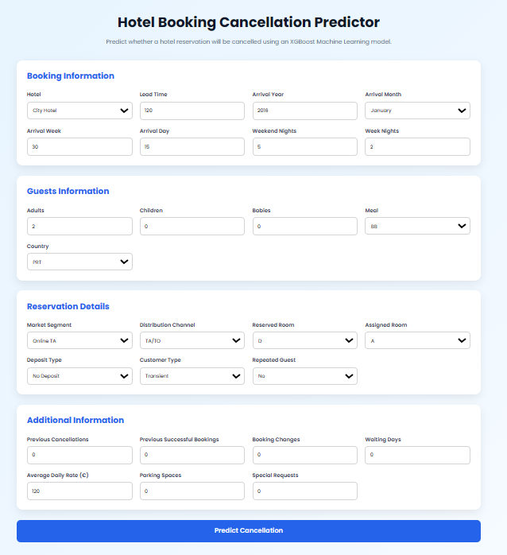

# Hotel Booking Cancellation Prediction
Hotel reservation cancellations are a major challenge for the hospitality industry. Guests often book rooms weeks or months in advance and may cancel their reservations before the check-in date. These cancellations can lead to revenue loss, inefficient room allocation, and inaccurate demand forecasting.

This project uses Machine Learning to predict the probability of a reservation being cancelled based on booking information available at the time of reservation, such as lead time, customer type, market segment, previous booking history, room type, and other reservation attributes.

The prediction can help hotel managers identify high-risk bookings, improve overbooking strategies, optimize room inventory, and support data-driven decision making before the cancellation actually occurs.


# Features

- Data Cleaning
- Data Analysis
- XGBoost Classification
- Model Persistence using Joblib
- FastAPI REST API


# Data Preprocessing

The preprocessing pipeline consists of the following steps:

- Removing unnecessary columns
- Handling missing values
- Country grouping (Top 10 + Other)
- One-Hot Encoding categorical features
- Saving preprocessing objects for inference

Removed columns:

- company
- agent
- reservation_status
- reservation_status_date

Missing Values:

| Feature | Method |
|----------|---------|
| country | Most Frequent |
| children | Median |

Country encoding:

```
 Top 10 Countries

        ↓

All Remaining Countries

        ↓

      Other
```

#  Machine Learning Model

Algorithm:

`XGBoost Classifier`

Why?

- High Accuracy
- Handles mixed features
- Robust to noisy data
- Excellent performance on tabular datasets

Hyperparameter tuning was applied to improve the model performance.

# Model Performance

The XGBoost classifier achieved an overall accuracy of **87%** on the test set.

The model performs particularly well in identifying reservations that are unlikely to be cancelled, while maintaining strong performance in detecting actual cancellations. This balance makes the model suitable for supporting operational decisions, where minimizing incorrect cancellation predictions is important for effective hotel management.

Classification Report:

|              |precision  |  recall  |  f1-score|
|--------------|-----------|----------|---------:|    
|Not Cancelled |    0.88   |   0.92   |   0.90   |
|Cancelled     |    0.85   |   0.78   |   0.81   |
|              | accuracy  |   87%    |          |      


# Web Application

The project includes an interactive web application built with:

- FastAPI
- HTML
- CSS
- JavaScript

Users can enter booking information through a web interface and instantly receive:

- Cancellation prediction
- Cancellation probability
- Non-cancellation probability

<p align="center">
  
</p>

The web interface communicates with the FastAPI backend, which preprocesses the input data and generates predictions using the trained XGBoost model in real time.

# API

Endpoint

```
POST/predict
```

Example Request

```json
{
  "hotel":"City Hotel",
  "lead_time":30,
  "arrival_date_year":2016,
  "arrival_date_month":"May",
  "country":"PRT",
  "...":"..."
}
```

Example Response

```json
{
  "prediction":0,
  "cancel_probability":0.12,
  "not_cancel_probability":0.88
}
```

# Installation

Clone the repository

```bash
git clone https://github.com/aminaminimh/Hotel_Booking.git
```

Go to project directory

```bash
cd Hotel_Booking
```

Install dependencies

```bash
pip install -r requirements.txt
```

Run the application

```bash
uvicorn src.app:app --reload
```

Open

```
http://127.0.0.1:8000
```

# Technologies

- Python
- Pandas
- NumPy
- Scikit-Learn
- XGBoost
- FastAPI
- Joblib
- HTML
- CSS
- JavaScript


# Future Improvements

- [ ] Deploy the application on Render
- [ ] Add Docker support
- [ ] Integrate SHAP for model explainability
- [ ] Improve the responsive user interface
- [ ] Implement model monitoring
- [ ] Visualize feature importance
- [ ] Add automatic data validation
- [ ] Support batch prediction using CSV files
- [ ] Add user authentication
- [ ] Train and compare additional ML models